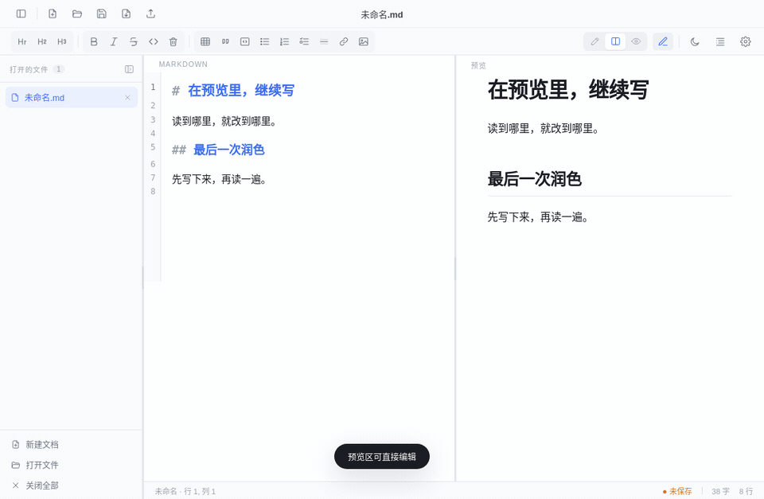
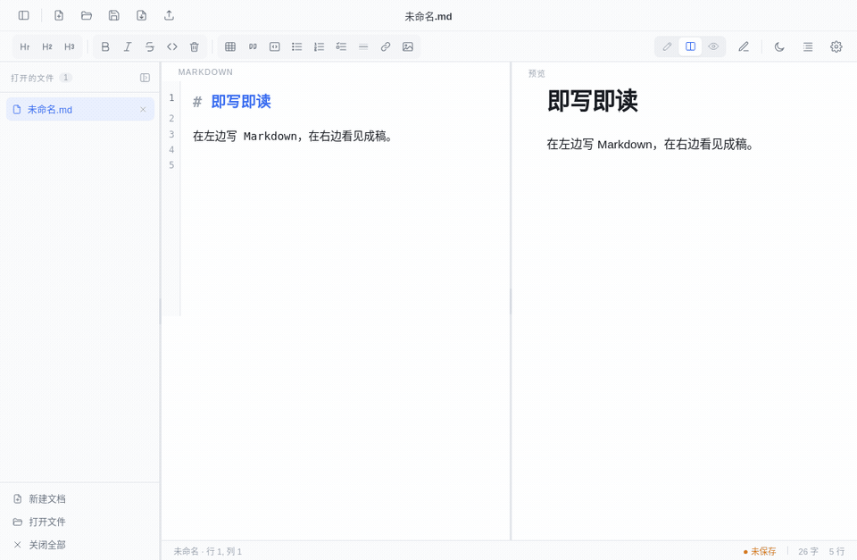
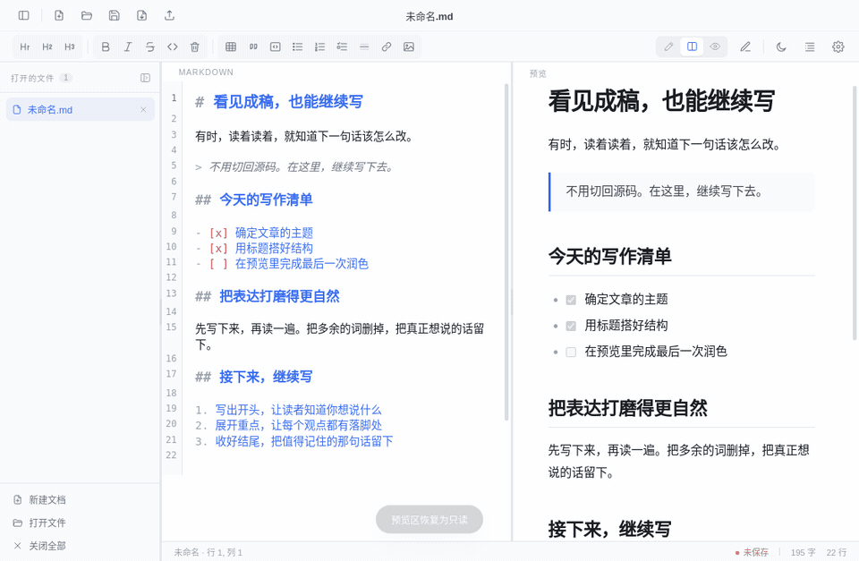

<div align="center">
  
  <h1>轻墨 QingMo</h1>
  <p><strong>即写即读，预览里也能直接改。</strong></p>
  <p>免费、轻量化简洁的 Markdown 编辑器，实时呈现成稿，让你专注写作。<br />打开就能写，不需要注册账号，也没有订阅门槛。</p>
  <p>
    <a href="https://github.com/engrecho/qingmo/releases/latest">免费下载</a> ·
    <a href="#轻量化设计让写作更直接">设计理念</a> ·
    <a href="#开始使用">开始使用</a> ·
    <a href="https://github.com/engrecho/qingmo/issues">反馈建议</a>
  </p>
  <p>Windows · macOS · Markdown · 本地文件 · 免费使用</p>
</div>

<p align="center">
  
</p>

<p align="center"><sub>轻一点，专心写。上方为用户提供视频转制的视觉动画；下方功能演示录自真实应用。</sub></p>

> 当前版本：**1.6.10** · [下载与版本说明](https://github.com/engrecho/qingmo/releases/tag/v1.6.10)。修复自动更新下载与 macOS 文件关联；功能 GIF 来自真实应用界面。

## 实时预览，专注写作

实时预览（WYSIWYG，所见即所得）让 Markdown 变成易读的成稿；简洁的界面减少干扰，把注意力留给文字。**预览不仅能看，也能直接编辑。** 支持源码、分栏、纯预览三种视图，按自己的习惯写作。

### 在预览里直接改，所见即所得

开启“预览区直接编辑”，可以直接在渲染后的段落里修改文字，并同步回 Markdown 源码。润色一句话、勾选任务、续写列表，都能在阅读的位置完成。



<p align="center"><sub>演示在右侧预览中真实输入补充句，并断言左侧 Markdown 已同步更新。</sub></p>

### 即写即读，想法立刻成形

在左侧输入 Markdown，右侧同步呈现标题、段落和列表。写作与阅读并排进行，随时检查文章的结构与排版。



## 免费使用，打开就能写

轻墨目前提供的编辑、预览、大纲、本地图片、HTML 与 PDF 导出等功能均可免费使用。无需购买许可证、开通会员或订阅，也不需要注册账号。

- **功能免费**：日常 Markdown 写作功能直接可用，无需付费解锁。
- **没有广告**：承诺永远不增加广告。
- **本地使用**：文字编辑与本地文件读写支持离线使用。
- **保持简洁**：功能够用即可，不做冗余功能。
- **即写即阅**：无需插件，预览实时更新。
- **预览修改**：预览模式下同样支持修改。

仓库公开源码，欢迎查看实现、反馈问题和参与改进。

## 轻量化设计，让写作更直接

轻墨围绕日常 Markdown 写作组织功能：打开文件、写下文字、查看排版、保存成稿。界面尽量简洁，常用工具容易找到，面板可以按需收起。

这里的“轻量”主要体现在界面与使用流程。轻墨基于 Electron，安装包大小和内存占用受运行时、文档内容与系统环境影响；当前没有提供体积或性能跑分。

### 浅色深色，一键切换

写 Markdown 时使用源码视图，边写边看时使用分栏，通读文章时切到纯预览。文件侧栏和大纲可以收起，浅色与深色主题覆盖编辑区和预览区。



<p align="center"><sub>同一篇文档，在浅色与深色之间切换；编辑区与预览区保持一致。</sub></p>

### 长文有大纲，文件用熟悉的格式

标题自动组成大纲，点击即可定位章节；修改标题后自动刷新。支持 H1–H6 和 Setext 标题，代码块中的标题标记不会混入目录。

文档直接保存为本地 Markdown，可以放在自己的文件夹、Git 仓库或已有同步目录中。无需先上传文档，也不依赖专有云端格式。本地图片支持相对路径或绝对路径，导出 HTML 时可嵌入图片，也可导出适合打印和分享的 PDF。

## 简洁，也保留常用功能

| 写作需要 | 轻墨支持 |
| --- | --- |
| 编辑与阅读 | 源码 / 分栏 / 纯预览，预览区直接编辑 |
| 文档导航 | 多标签、未保存圆点、文件重命名、最近关闭列表、标题大纲 |
| Markdown 排版 | 标题、引用、代码块、表格、链接、列表与任务列表 |
| 列表与格式 | 列表自动续写、指定编号起点、清除当前行格式 |
| 图片与导出 | 本地图片预览、HTML / PDF 导出，支持本地图片 |
| 外观 | 浅色 / 深色主题，可收起侧栏与大纲 |
| 保存保护 | 按内容判断修改、关闭全部列出文件名、空白新文档免确认、会话暂存 |
| 关闭行为 | 可选关闭窗口后留后台，实际退出时检查全部未保存文件 |
| 更新 | 检查 GitHub Release、下载安装包、提示用户安装 |

关闭有未保存修改的文档时，可以选择“保存并关闭 / 放弃保存 / 返回确认”；放弃保存还需二次确认。会话暂存可以帮助恢复写作现场，请仍主动保存和备份重要文档。

## 文件管理，少一点打断

- **未保存一眼可见**：侧栏文件名右侧显示圆点；保存或撤销回已保存内容后消失。打开、切换文档不会被当成编辑。
- **空白新文档直接关闭**：未输入内容，或新文档输入后全部清空，无需确认。已有文件被清空但未保存仍会提醒。
- **文件重命名**：双击侧栏文件名或顶部标题，也可按 F2。已有文件在原目录重命名，保留未保存的编辑，不覆盖同名文件；新文档可先命名，保存时再选择位置。
- **找回最近关闭的文件**：侧栏“最近关闭”列出最近 20 个文件，显示完整路径；Ctrl/Cmd+Shift+T 重新打开上一个，重启后仍保留记录。明确放弃的修改不会被恢复。
- **按习惯选择关闭行为**：设置 → 文件 → “关闭窗口后留在后台”，开启后关闭窗口保留文档。Mac 点击 Dock 图标可返回，Cmd+Q 执行关闭全部并列出未保存文件；取消退出会回到编辑器。Windows 可重新启动轻墨返回原窗口，通过 Ctrl+Q 或设置中的“退出应用”退出。

## 导出 PDF，把成稿带走

点击顶部的 **PDF 导出图标**，或选择“文件 → 导出 PDF…”，选择保存位置即可。文档按 A4 分页，使用浅色打印样式，保留标题、列表、表格与可用图片；不会把编辑器工具栏、侧栏或深色背景一起打印。

导出使用当前编辑内容，无需先保存 Markdown。请确保图片可读取、远程图片网络可用；字体效果取决于本机已安装字体。PDF 导出自 1.6.8 起提供，旧版用户请先更新。

## 下载与安装

前往 **[GitHub Releases 免费下载](https://github.com/engrecho/qingmo/releases/latest)**，按电脑系统选择安装包。可用版本与架构以发布页为准。

| 电脑 | 安装包 | 安装方式 |
| --- | --- | --- |
| Windows x64 | `QingMo-版本号-win-setup.exe` | 按安装向导完成安装。 |
| Windows x64，免安装 | `QingMo-版本号-win-portable.exe` | 直接运行；移动后可能需要重新设置文件关联。 |
| Mac Apple 芯片（M 系列） | `QingMo-版本号-mac-arm64.dmg` | 打开 DMG，将轻墨拖入“应用程序”。 |

Mac ZIP 为备用分发方式；Intel Mac 请选择明确标注 `mac-x64` 的包。更新前请保存文档并退出旧版。

当前 Mac 包使用本地签名，尚未完成 Apple 公证。若系统阻止打开，请核实下载来源，并按“隐私与安全性”中的系统提示处理，无需关闭整个系统的安全检查。

安装详情：[Windows 使用说明](docs/Windows使用说明.md) · [macOS 使用说明](docs/macOS使用说明.md)

## 开始使用

1. **打开或新建文档**：从工具栏开始，也可以打开已有的 `.md` 文件。
2. **选择视图**：分栏查看排版、源码编辑，或在预览中直接润色。
3. **按需打开大纲**：用标题整理文章，点击大纲跳转章节。
4. **保存文件**：按 Ctrl/Cmd+S，首次保存时选择本地位置。

可以先打开仓库中的[写作示例](docs/examples/把想法写下来.md)、[阅读示例](docs/examples/让阅读安静一点.md)或[预览编辑示例](docs/examples/直接在预览里修改.md)。功能演示使用公开示例与专用演示文字，不包含用户文档。

### 常用快捷键

macOS 使用 **Cmd**，Windows 使用 **Ctrl**。

| 操作 | 快捷键 |
| --- | --- |
| 新建 / 打开 / 保存 | Ctrl/Cmd+N / O / S |
| 源码 / 分栏 / 预览 | Ctrl/Cmd+1 / 2 / 3 |
| 开关预览直接编辑 | Ctrl/Cmd+Shift+P |
| 清除当前行格式 | Ctrl/Cmd+\ |
| 切换深色模式 | Ctrl/Cmd+D |
| 插入表格 | Ctrl/Cmd+T |
| 另存为 / 导出 HTML | Ctrl/Cmd+Shift+S / E |
| 关闭当前标签 | Ctrl/Cmd+W |
| 重新打开上次关闭的文件 | Ctrl/Cmd+Shift+T |
| 重命名文件 | F2 / 双击文件名 |

## 常见问题

> 更新提示：1.6.9 及更早版本的下载器遇到 GitHub 重定向可能报错，请先从 [v1.6.10 发布页](https://github.com/engrecho/qingmo/releases/tag/v1.6.10) 手动下载安装一次；新版本已修复该问题。

<details>
<summary><strong>免费使用需要登录或上传文档吗？</strong></summary>

不需要。当前功能免费使用，文字编辑和本地文件读写无需账号或网络。文档保存在你选择的位置；更新检查、远程图片和外部链接需要联网。诊断日志和会话暂存保存在本机，分享日志前请检查文件路径等信息。

</details>

<details>
<summary><strong>轻量化是否意味着安装包很小、内存占用极低？</strong></summary>

轻墨强调简洁的界面、直接的操作和本地文件工作流。应用使用 Electron，包含桌面运行时；目前没有公布安装体积、启动速度或内存占用的对比数据。实际体验请以对应版本和自己的设备为准。

</details>

<details>
<summary><strong>预览直接编辑适合什么内容？</strong></summary>

适合修改常规 Markdown 段落、标题、列表和表格等内容。复杂嵌套结构或自定义 HTML 建议同时检查源码，预览编辑不保证任意富文本格式的无损转换。

</details>

<details>
<summary><strong>设为默认编辑器后，为什么文件图标还没变化？</strong></summary>

默认打开方式、文件图标和文档缩略图由系统分别管理。Mac 可在 Finder“显示简介 → 打开方式”中选择轻墨并点“全部更改”；Mac 和 Windows 均可在轻墨设置中修复文件关联；Mac 请先安装到 Applications。Windows 优先使用安装版。便携版移动后可能需要重新关联，系统图标缓存也可能延迟更新。

</details>

## 开发与参与

轻墨基于 **Electron、CodeMirror 6、marked 与 DOMPurify**，开发需要 Node.js ≥ 18 和 npm。在仓库根目录执行：

```bash
npm --prefix dev ci
npm --prefix dev start
```

若设置了 `ELECTRON_RUN_AS_NODE`，启动桌面程序前先取消该变量。

- [开发指南](docs/开发指南.md)：代码架构、交互约定与回归验证。
- [发布指南](docs/发布指南.md)：双端打包、Mac 签名与安装包校验。
- [截图说明](docs/截图说明.md)：复现 README 的真实界面截图。
- [Issues](https://github.com/engrecho/qingmo/issues)：报告问题、提出建议。

反馈时请附上系统版本、轻墨版本、复现步骤和可公开的最小示例。应用元数据声明 MIT；分发时请保留第三方依赖的许可证。

## Buy me a coffee

如果轻墨对你有帮助，可以通过反馈问题、分享给朋友、参与改进或自愿打赏来支持维护。

<p align="center">
  <br />
  <sub>扫码前请在支付平台确认收款对象。打赏不兑换付费权益。</sub>
</p>
