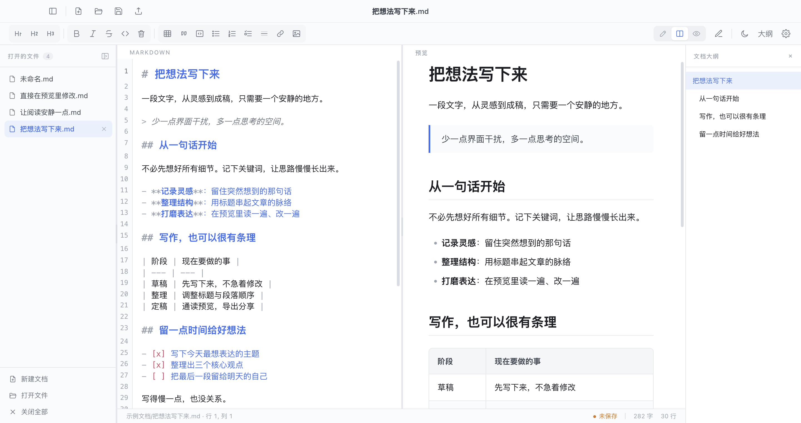
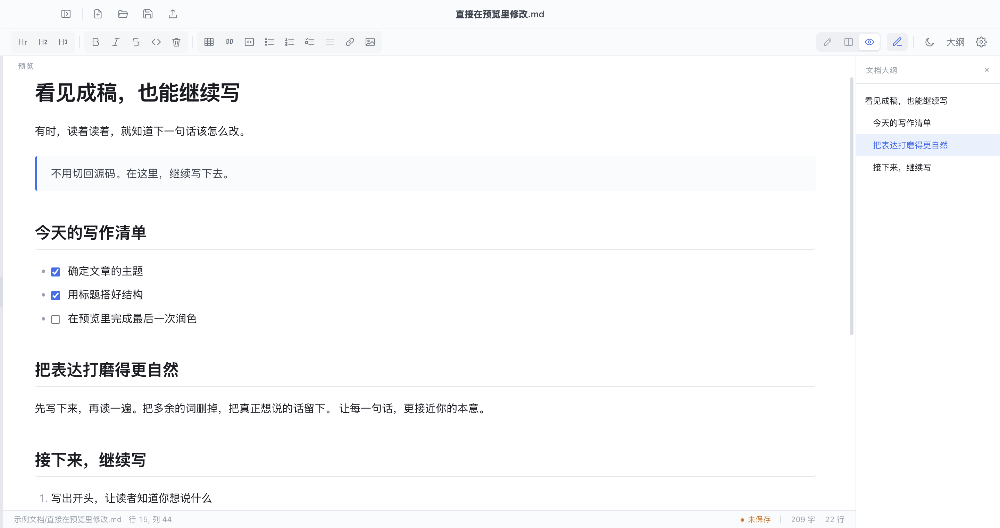
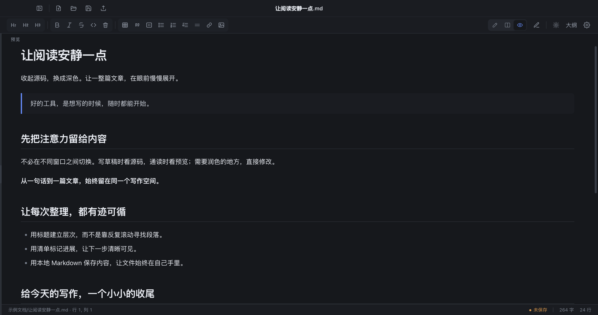

<div align="center">
  
  <h1>轻墨 QingMo</h1>
  <p><strong>写得顺手，读得舒服。</strong></p>
  <p>从记下一个想法，到认真完成一篇文章。<br />源码、预览与大纲，放在同一个安静的写作空间。</p>
  <p>
    <a href="https://github.com/engrecho/qingmo/releases/latest">下载轻墨</a> ·
    <a href="#为什么选择轻墨">了解特点</a> ·
    <a href="#开始使用">开始使用</a> ·
    <a href="https://github.com/engrecho/qingmo/issues">反馈建议</a>
  </p>
  <p>Windows · macOS · Markdown · 本地文件</p>
</div>



<p align="center"><sub>真实应用截图：在源码里组织想法，在预览里看见成稿，用大纲把握文章结构。</sub></p>

> 当前版本：**1.6.7** · [查看版本说明](https://github.com/engrecho/qingmo/releases/tag/v1.6.7)。下方截图来自真实应用界面。

## 为什么选择轻墨

轻墨希望把写作中反复发生的小动作，变得自然一点：记下一句话，调整一个标题，通读一段文字，再把文件好好保存。

| 你在意的事 | 轻墨的做法 |
| --- | --- |
| 写的时候，想立刻看到效果 | 源码与预览并排显示，结构和排版一起看。 |
| 读到不顺的地方，想直接修改 | 开启预览直接编辑，在渲染后的正文里继续写，同步回 Markdown。 |
| 文档变长后，不想反复翻找 | 标题自动组成大纲，点击章节跳转；不用时可以关掉。 |
| 想专注眼前这篇文字 | 源码、分栏、纯预览自由切换，文件栏与大纲按需收起，支持深色主题。 |
| 希望文件留在自己手里 | 直接读写本地 Markdown，不需要注册账号，也不必先把文档上传到云端。 |

### 01 · 写草稿，也能看见成稿

Markdown 适合快速组织结构，预览适合判断阅读效果。轻墨把两者放在一起：左边写标题、列表和表格，右边查看排版。需要更多空间时，一次切换就能只保留源码或预览。

记录灵感时先写下来；整理长文时看结构；准备分享时通读成稿。**同一份文档，可以用不同的方式完成。**

### 02 · 读到哪里，就改到哪里

开启“预览区直接编辑”，可以直接在渲染后的段落里修改文字，不必为了润色一句话再去源码中寻找位置。

任务清单可以直接勾选，列表按 Enter 自动续写；需要调整有序列表起点时，点击序号即可选择从 1 或指定数字开始。清除当前行格式，也有独立按钮和快捷键。



<p align="center"><sub>截图中的补充句通过预览区实际输入，并验证已经同步回 Markdown 源码。</sub></p>

### 03 · 长文章，也有清晰的路标

标题不仅是排版，也是文章的骨架。右侧大纲自动整理 H1–H6 与 Setext 标题，点击即可跳转；修改标题后自动刷新，代码块中的 `#` 不会混进目录。

左侧管理打开的文件，右侧查看当前文档结构。**在不同文章之间切换，在同一篇文章里快速定位。** 大纲可单独关闭，并记住开关状态。

### 04 · 把界面收起来，把注意力留下来

想安静地读一遍，就切到纯预览，收起两侧面板。浅色与深色主题同时覆盖编辑器和预览区，让界面适应你的使用习惯。



<p align="center"><sub>同一个编辑器，也可以是一处简洁的阅读空间。</sub></p>

### 05 · 文件在本地，写作更自主

轻墨直接打开和保存本地 Markdown 文件。文档可以放在自己的文件夹、版本仓库或已有同步目录中，不必依赖轻墨专有的云端格式。

插入本地图片时，可以使用相对路径或绝对路径；导出 HTML 时，本地图片会嵌入导出文件，方便把文章连同图片一起分享。

未保存的修改有明确的关闭保护：**保存并关闭、放弃保存、返回确认**。选择放弃还需二次确认；取消保存或保存失败，文档继续保持打开。会话暂存可帮助恢复写作现场，但不能替代主动保存和备份。

## 日常写作需要的功能，都在顺手的位置

| 功能 | 支持情况 |
| --- | --- |
| 编辑与预览 | 源码 / 分栏 / 纯预览，预览区直接编辑 |
| 文档导航 | 多标签、文件侧栏、标题大纲、章节跳转 |
| 常用 Markdown | 标题、引用、代码块、表格、链接、列表与任务列表 |
| 列表与格式 | 自动续写、指定编号起点、清除当前行格式 |
| 图片与导出 | 本地图片预览、HTML 导出并嵌入本地图片 |
| 外观 | 浅色 / 深色主题，可收起侧栏和大纲 |
| 保存保护 | 未保存提示、放弃二次确认、会话暂存 |
| 更新 | 检查 GitHub Release、后台下载安装包、提示用户安装 |

## 下载与安装

前往 **[GitHub Releases 下载](https://github.com/engrecho/qingmo/releases)**，选择适合自己电脑的安装包。

| 电脑 | 推荐下载 | 如何安装 |
| --- | --- | --- |
| Windows x64 | `QingMo-版本号-win-setup.exe` | 按安装向导完成安装。 |
| Windows x64，想免安装使用 | `QingMo-版本号-win-portable.exe` | 直接运行；移动位置后可能需要重新设置文件关联。 |
| Mac Apple 芯片（M 系列） | `QingMo-版本号-mac-arm64.dmg` | 打开 DMG，将轻墨拖入“应用程序”。 |

Mac ZIP 为备用分发方式。Intel Mac 请只选择明确标注 `mac-x64` 的包，不要用 arm64 包代替；可用架构以具体发布页为准。更新已有 Mac 应用前，请保存文档并退出旧版。

当前 Mac 包使用本地签名，尚未完成 Apple 公证。若系统阻止打开，请核实下载来源后按照“隐私与安全性”的系统提示处理，无需关闭整个系统的安全检查。

## 开始使用

1. **打开或新建文档**：从工具栏开始，也可以打开已有 `.md` 文件。
2. **选一种顺手的视图**：分栏写作、纯源码编辑，或直接在预览里润色。
3. **用标题整理文章**：点击“大纲”查看章节，点击标题快速跳转。
4. **保存自己的文字**：按 Ctrl/Cmd+S；第一次保存时选择文件位置。

想先体验界面，可以打开仓库里的[写作示例](docs/examples/把想法写下来.md)、[阅读示例](docs/examples/让阅读安静一点.md)或[预览编辑示例](docs/examples/直接在预览里修改.md)。本文截图由这些公开示例生成，不包含用户文档。

### 几个值得记住的快捷键

macOS 使用 **Cmd**，Windows 使用 **Ctrl**。

| 操作 | 快捷键 |
| --- | --- |
| 新建 / 打开 / 保存 | Ctrl/Cmd+N / O / S |
| 源码 / 分栏 / 预览 | Ctrl/Cmd+1 / 2 / 3 |
| 开关预览直接编辑 | Ctrl/Cmd+Shift+P |
| 清除当前行格式 | Ctrl/Cmd+\ |
| 切换深色模式 | Ctrl/Cmd+D |
| 插入表格 | Ctrl/Cmd+T |
| 另存为 / 导出 HTML | Ctrl/Cmd+Shift+S / E |
| 关闭当前标签 | Ctrl/Cmd+W |

更完整的说明：[macOS 使用说明](docs/macOS使用说明.md) · [Windows 使用说明](docs/Windows使用说明.md)

## 常见问题

<details>
<summary><strong>需要账号或联网才能写作吗？</strong></summary>

文字编辑与本地文件读写不需要账号或网络。更新检查、远程图片和外部链接需要网络。当前没有账号同步、广告系统或应用内付费服务。

更新检查访问官方 GitHub 仓库，安装包下载后校验大小和 SHA256，再提示用户安装；不会自行替换正在运行的应用。诊断日志和会话暂存保存在本机，反馈日志前请检查其中的文件路径等信息。

</details>

<details>
<summary><strong>设置默认编辑器后，Markdown 文件为什么还没有显示轻墨图标？</strong></summary>

默认打开方式、文件类型图标和文档缩略图由系统分别管理。1.6.7 已修正 Mac 文档 ICNS 与 Windows ICO 声明。

- Mac：安装到“应用程序”，在 Finder 的“显示简介 → 打开方式”中选择轻墨并点“全部更改”。如果看到正文缩略图，可在 Finder 显示选项中关闭“显示图标预览”后检查。
- Windows：优先使用安装版；在轻墨设置中修复文件关联，再检查 Windows 默认应用。便携版移动后，旧的图标路径可能失效。

系统缓存和其他软件的关联声明仍可能影响显示，设置默认打开方式不等于强制清除全部图标缓存。

</details>

<details>
<summary><strong>预览直接编辑适合什么内容？</strong></summary>

适合在常规 Markdown 文档中修改段落、标题、列表、表格等内容。处理复杂的嵌套结构或自定义 HTML 时，建议保留源码视图检查结果；不要把预览编辑当作任意富文本格式的无损转换器。

</details>

## 开发与参与

轻墨基于 **Electron、CodeMirror 6、marked 与 DOMPurify**。需要 Node.js / npm：

```bash
npm --prefix dev ci
npm --prefix dev start
```

若环境设置了 `ELECTRON_RUN_AS_NODE`，运行桌面程序前先取消该变量。

- [开发指南](docs/开发指南.md)：代码架构、交互约定与回归验证。
- [发布指南](docs/发布指南.md)：双端打包、Mac 签名、安装包校验和 GitHub 发布。
- [截图说明](docs/截图说明.md)：重新生成本文的真实界面截图。
- [Issues](https://github.com/engrecho/qingmo/issues)：报告问题或提出改进建议。

反馈问题时，请提供系统版本、轻墨版本、复现步骤和可公开的最小示例。应用元数据声明 MIT，分发时也请保留第三方依赖的许可证。

## 支持轻墨，继续认真打磨

如果轻墨帮你更顺手地写下一些东西，欢迎自愿支持后续维护。打赏不影响当前功能使用，也不自动兑换付费权益。

<p align="center">
  <br />
  <sub>感谢每一份支持。扫码前请在支付平台确认收款对象。</sub>
</p>

目前只提供作者二维码，尚未接入应用内支付或到账识别。打赏入口、专业版和渠道上架属于后续规划，具体建议见[商业化与渠道建议](docs/商业化与渠道建议.md)。
